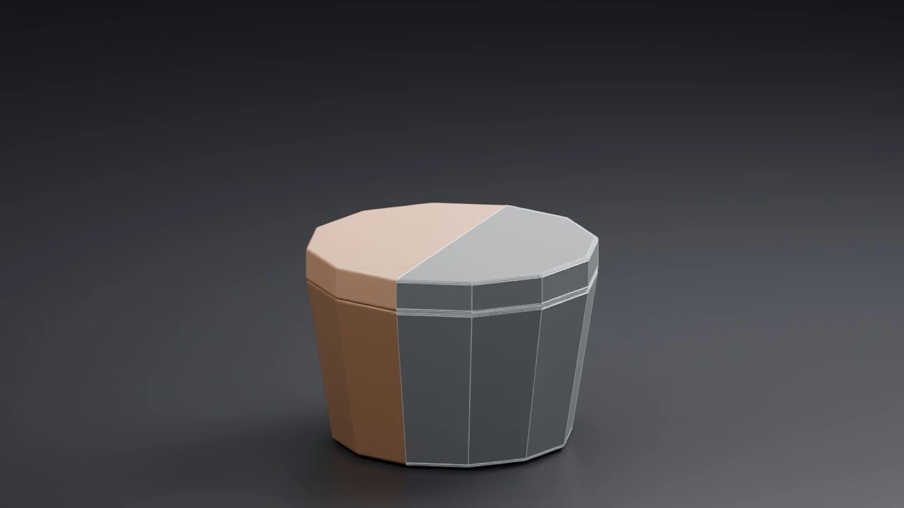

---

group: "low-poly-vs-high-poly"
title: "Low poly ou high poly num visualizador de produto"
description: "Escolha a detalhamento da malha com base na distância da câmera, na silhueta e no dispositivo alvo, e não em um limite de triângulos."
date: 2026-12-16
updated: 2026-12-16
keyword: "low poly vs high poly"
cta: "Reveja os ângulos do seu produto numa pré-visualização gratuita."
---

Escolha o nível de detalhamento da malha com base nas necessidades do comprador. Mantenha a geometria nos traços, curvas e fendas que importam quando o produto é visto de diferentes ângulos. Utilize texturas para detalhes superficiais finos, sempre que possível. Compare duas versões na dimensão real do catálogo e no zoom máximo permitido pelo visualizador.

## Qual detalhe deve permanecer como geometria?

Mantenha as bordas das pernas da cadeira, as aberturas dos handles e o bordo de um recipiente se esses elementos influenciam a silhueta ou o paralaxe. Aplicar pintura ou bake para detalhes superficiais finos, desde que não alterem o contorno. Revise os bordes em sombra e reflexos, assim como a própria malha.

## Como definir o alvo?

O nosso cofre de café tem 16,228 triângulos e a nossa mesa de cabeceira tem 69,910.. Ambos utilizam um único material. Trata-se de dois objetos distintos, por isso nenhum número representa um orçamento universal. Para uma decisão, compare duas exportações do mesmo objeto, com o mesmo quadro, material e dispositivo.

## O que deve ser verificado antes da publicação?

| Em que pontos é crítico           | Manter ou testar                          |
| --------------------------------- | ----------------------------------------- |
| Silhueta externa                  | Verifique a linha no frente e no perfil   |
| Elementos de hardware e aberturas | Preserve as falhas reais e interseções    |
| Detalhe da textura superficial    | Teste detalhes da textura em zoom elevado |

<!-- IMAGE PENDING: Photograph or capture the example described in the brief. -->

**Fonte** [Blender · Modificador Decimate](https://docs.blender.org/manual/en/latest/modeling/modifiers/generate/decimate.html), [Khronos · especificação glTF 2.0](https://registry.khronos.org/glTF/specs/2.0/glTF-2.0.html), [model-viewer · documentação](https://modelviewer.dev/docs/).

[Guia relacionado](/learn/glb-file)

[Como criar um modelo 3D](/pt/guias/como-criar-um-modelo-3d)

## Perguntas frequentes

### Existe um limite padrão para low-poly?

Defina um limite de low-poly com base nas especificações da página alvo, câmera e dispositivo. Teste a velocidade de carregamento e rotação em dispositivos com suporte. Verifique a taxa de quadros e o tempo de carregamento de texturas para interação fluida. Confirme o desempenho no dispositivo de menor especificação do público-alvo.

### O que devo simplificar em primeiro lugar?

Simplifique primeiramente bordes de pernas e aberturas de handles para manter a silhueta. Exporte duas versões do mesmo objeto com o mesmo material para comparação direta. Cometa a falha de eliminar aberturas reais, o que altera o paralaxe e a aparência em ecrã.

### Um mapa normal preserva detalhes da silhueta?

Utilize um mapa normal para detalhes superficiais superficiais. Não preserva detalhes da silhueta. Mantenha a geometria base onde a forma altera a linha da silhueta ou cria uma abertura visível. Verifique que a silhueta do modelo low-poly permaneça afiada e visível no visualizador 3D.
