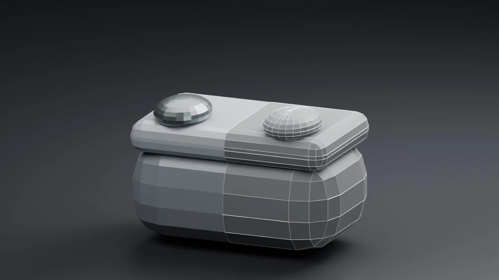
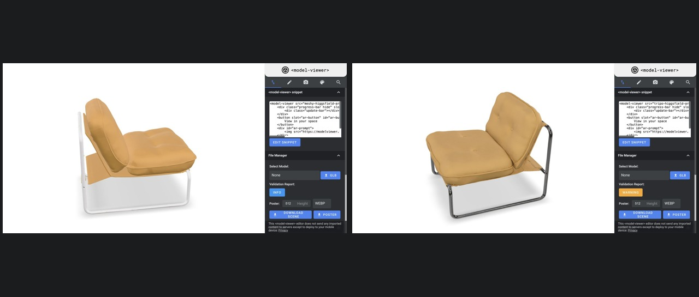

---

group: "meshy-vs-tripo"
title: "Meshy ou Tripo para fotografias de produto"
description: "Compare Meshy e Tripo numa mesma fotografia de produto. Verifique silhuetas, detalhes, materiais e o que é possível exportar."
date: 2026-11-23
updated: 2026-11-23
keyword: "Meshy vs Tripo"
cta: "Reveja os ângulos do seu produto numa pré-visualização gratuita."
publishAt: "2026-11-23"
---

Compare Meshy e Tripo com a mesma foto de produto sem recorte, depois avalie o resultado na vista que realmente é necessária. Para um modelo de loja, verifique a silhueta e a parte posterior antes de avaliar a polida. A decisão baseia-se no ficheiro exportado se o próximo passo for Shopify, Blender ou outro visualizador.

## Quando escolher Meshy ou Tripo?

- **Começa pelo Meshy** se queres comparar uma fotografia e várias vistas diretamente na aplicação web. Coloca primeiro a vista frontal e junta até três fotografias do mesmo acabamento. [Guia de imagens do Meshy](https://docs.meshy.ai/en/webapp/image-to-3d).
- **Começa pelo Tripo** se o teu fluxo já identifica frente, traseira e laterais ou se precisas de editar uma malha de quadriláteros. A API aceita vistas identificadas e disponibiliza um modelo com topologia nativa de quadriláteros. [API multivista do Tripo](https://developers.tripo3d.com/en/docs/generation-multiview-to-model/standard), [modelo Tripo P2](https://developers.tripo3d.com/en/models/p2).

Se tens uma só fotografia e queres entregar um GLB, abre os dois ficheiros no mesmo visualizador antes de escolher. Confirma primeiro a traseira, as peças finas e os materiais.

## O que tornaria um instrumento uma escolha superior?

| Se o trabalho é…                        | Decida com base em…                                       |
| --------------------------------------- | --------------------------------------------------------- |
| Mostre o produto de outra perspetiva    | Silhueta reconhecível, aberturas e pés                    |
| Adaptar ao acabamento de catálogo       | Continuidade de textura e detalhes visíveis na foto       |
| Entregar um modelo para outra aplicação | Exportação real, tamanho do ficheiro e resultado reaberto |
| Manter os custos de produção baixos     | Créditos e tempo de edição por modelo aprovado            |

## O que medimos a partir da mesma foto?

Enviamos a mesma foto de sofá para os dois modelos no 15 em Novembro e abrimos os ficheiros em um mesmo visualizador externo. As execuções utilizaram créditos Higgsfield já disponíveis na conta. As configurações registadas diferiram em PBR e tratamento de textura.

| Ficheiro GLB guardado |     Bytes | Triângulos | PBR ativado |
| --------------------- | --------: | ---------: | ----------- |
| Meshy 7               | 2,824,116 |     27,415 | Não         |
| Tripo H3.1            | 3,846,052 |     27,067 | Sim         |

Trate a tabela como um registo dos dois ficheiros. Para uma decisão de compra com base na malha, na fidelidade do material ou na velocidade, execute ambos com configurações equivalentes e utilize a mesma câmera. [Abra o registo de medição](/benchmarks/2026-11-15/measurements.json)

## Como se realiza a reprodução da comparação?

Utilize uma imagem com uma referência de fundo ou lateral exposta para revisão. Registe a data, modo, revisão e número de imagens de entrada para ambos os ferramentas. Capture os mesmos ângulos frontal, traseiro e lateral.

Marque cada critério como confirmado, incerto ou errado. Se um exportado estiver disponível, abra-o num visualizador separado e anote as configurações do visualizador. Trate o acesso ao ficheiro como um critério próprio.

## O que deve ser verificado antes da publicação?

| Verifique                  | Registe                                         |
| -------------------------- | ----------------------------------------------- |
| Silhueta frontal e lateral | Onde a linha de contorno diverge                |
| Lateral e face inferior    | Quais estruturas visíveis podem ser confirmadas |
| Exportar                   | Se o ficheiro aberto contém texturas            |

**Fonte** [Meshy · imagem para 3D](https://docs.meshy.ai/en/webapp/image-to-3d), [Tripo · imagem para 3D](https://developers.tripo3d.com/en/docs/generation-image-to-model/standard), [Khronos · especificação glTF 2.0](https://registry.khronos.org/glTF/specs/2.0/glTF-2.0.html)

[Guia relacionado](/pt/comparacoes/meshy)

[Como criar um modelo 3D](/pt/guias/como-criar-um-modelo-3d)

## Perguntas frequentes

### Qual ferramenta devo tentar primeiro?

Comece com a que oferece o modo de entrada necessário e exportação no formato que pode utilizar. Posteriormente escolha com base no mesmo objeto, e não em exemplos não relacionados de cada demonstração. Abra o registo de medição para comparar as configurações e critérios de cada ferramenta em condições equivalentes.

### Posso comparar um screenshot com um modelo exportado?

Sim, é possível comparar um screenshot com um modelo exportado. Carregue o ficheiro GLB no visualizador externo e verifique a continuidade de textura e detalhes visíveis. Um erro comum é ignorar o PBR ativo, que afeta a aparência da textura no modelo Tripo.

### O que constitui uma imagem de entrada justa?

Uma imagem de entrada justa é aquela com silhueta reconhecível, aberturas e pés visíveis. Carregue a mesma foto em ambos os ficheiros com configurações de PBR desativado. O erro comum é ignorar a continuidade de textura, o que afeta a validade da comparação.
