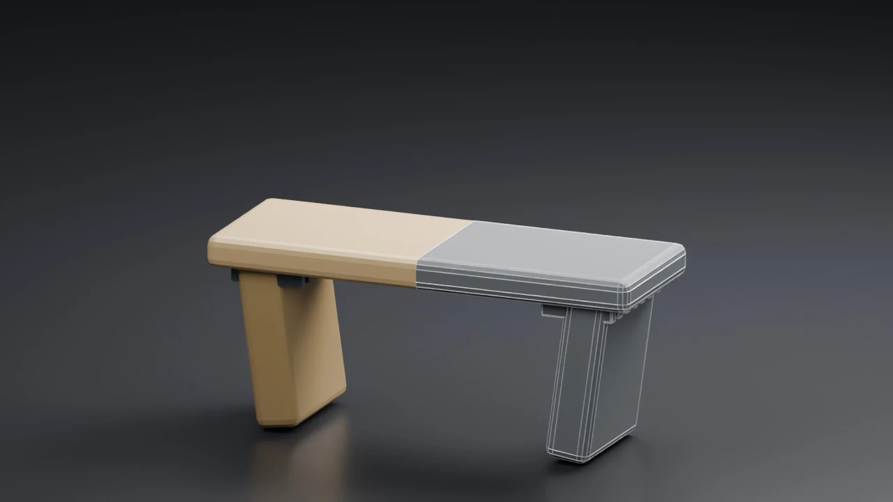
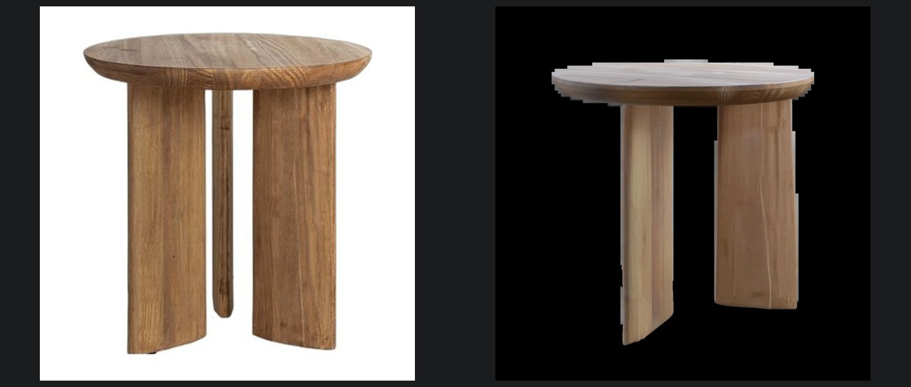

---

group: "furniture-model-from-photo"
title: "Criar um modelo 3D de um móvel a partir de uma foto"
description: "Prepare uma fotografia de móvel, verifique os ângulos gerados e revise o modelo antes de o utilizar em um catálogo."
date: 2026-11-27
updated: 2026-11-27
keyword: "modelo 3D móvel a partir de fotografia"
cta: "Reveja os ângulos do seu produto numa pré-visualização gratuita."
---

Comece por uma foto nítida que mostre a frente, um lado e os pés do móvel. Revise os ângulos gerados para as suas partes distintivas antes de construir o modelo. Após a exportação, abra o GLB real separadamente e verifique a silhueta, superfícies e detalhes na escala que os compradores verão.

## Qual imagem deve-se utilizar como base?

Utilize uma vista de três quartos com o móvel isolado. Deixe espaço abaixo dos pés e evite objetos que cubram a linha de contorno. Fixe a exposição para que uma mesa iluminada mantenha detalhes e os elementos metálicos escuros permaneçam visíveis. Mantenha fotografias reais das outras superfícies para revisão.

## Como se aceita o modelo?

Compare a prévia com a fonte e as vistas de referência. Conte os pés, as alças e as aberturas. Abra o modelo construído, gire-o e verifique as junções e o lado inferior. O GLB público de mesa de café tem triângulos 16,228 e requer 322,876 bytes. Meça o seu ficheiro contra o orçamento do destino.

## O que deve-se verificar antes da publicação?

| Verifique         | Aceite quando                                   |
| ----------------- | ----------------------------------------------- |
| O número de peças | As peças visíveis coincidem com a referência    |
| Finalização       | O produto permanece reconhecível sob luz neutra |
| Exportação        | Abre-se no visualizador pretendido              |

**Fonte** [Khronos · especificação glTF 2.0](https://registry.khronos.org/glTF/specs/2.0/glTF-2.0.html), [Khronos · validador glTF](https://github.com/KhronosGroup/glTF-Validator), [Shopify · criação de modelos 3D](https://help.shopify.com/en/partners/manage-clients-stores/creating-media/3d-models/creating-3d-models).

[Guia relacionado](/pt/guias/criar-um-modelo-3d-a-partir-de-fotografias)

[Como criar um modelo 3D](/pt/guias/como-criar-um-modelo-3d)

## Perguntas frequentes

### Devo fotografar o verso separadamente?

Mantenha-o como referência se o verso descreva algo relevante. Um ângulo gerado é uma previsão. Utilize fotografias físicas para detalhes que devem ser confirmados.

### O que se faz se um pé fino se fundir com o fundo?

Se uma perna fina se mistura ao fundo, ajuste o fundo ou a iluminação para definir o seu contorno. Mantenha uma distância adequada da câmera para capturar todo o objeto quando as pernas se estendem. Em seguida, verifique que o contorno da perna está claramente visível na foto antes da modelação.

### Qual ficheiro devo enviar à fábrica?

Comece pelo formato aceite pelo destino. Teste o ficheiro transferido e mantenha as fotografias de referência e a versão editável de origem. Verifique a dimensão do ficheiro GLB gerado para garantir que respeite os limites de tamanho estabelecidos pelo destino.
