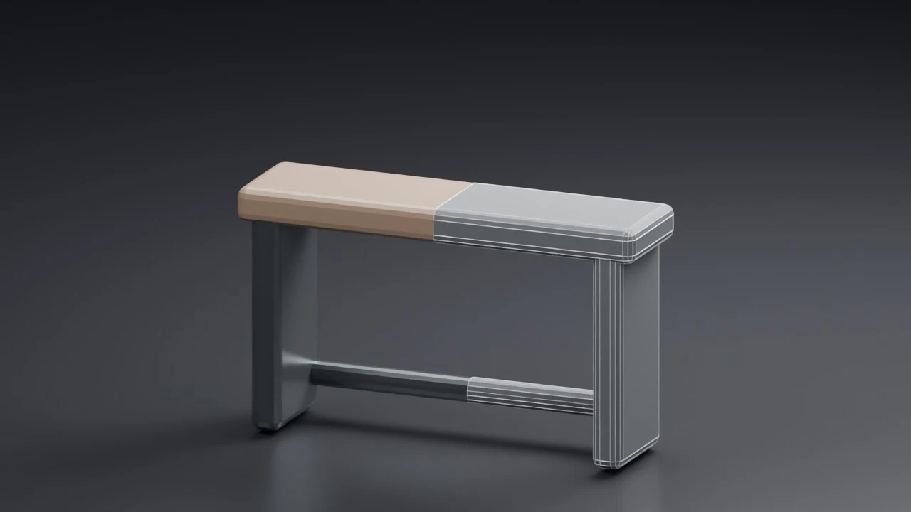
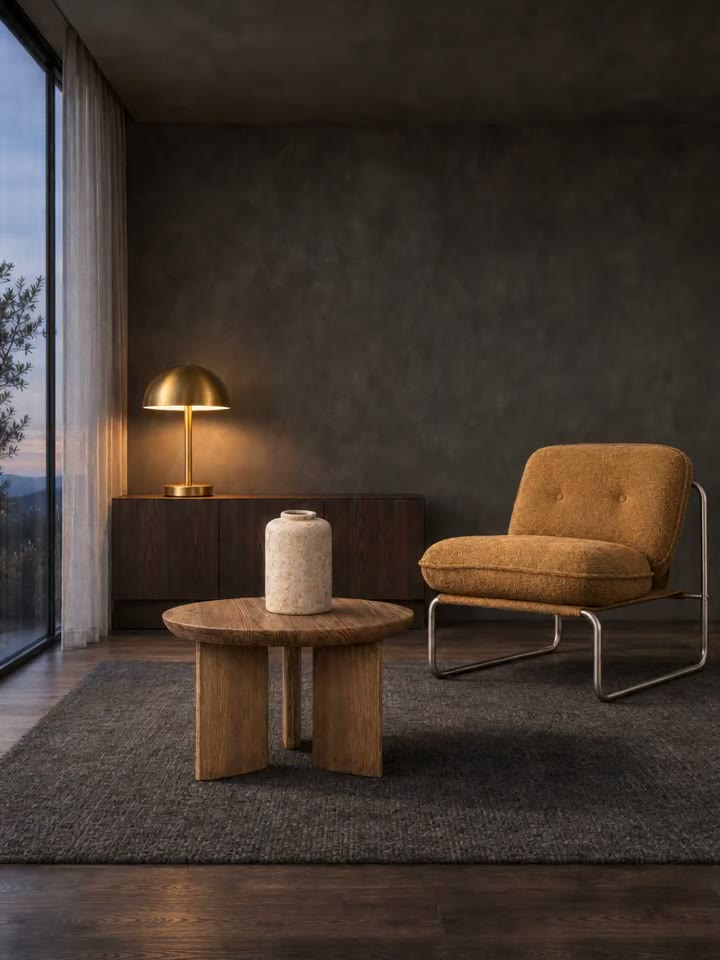

---

group: "3d-furniture-models-home-staging"
title: "Usar modelos 3D de móveis no home staging"
description: "Inscreva um modelo de móvel existente numa cena de sala, depois verifique a proporção, contacto com o chão e iluminação."
date: 2026-12-08
updated: 2026-12-08
keyword: "modelos 3D móveis home staging"
cta: "Reveja os ângulos do seu produto numa pré-visualização gratuita."
---

Adicione um modelo de móvel a uma cena de sala existente verificando a sua orientação e ponto de pivô. Utilize dimensões independentemente validadas para configurar o objeto no editor. Ajuste a iluminação, coloque o objeto no chão e revise a cena a partir da câmera final e de uma vista secundária.

## Como se prepara o objeto?

Abra uma cópia no editor da cena. Verifique a direção que é considerada para frente e se o ponto de pivô torna a colocação previsível. Defina as unidades segundo o briefing do projeto e utilize especificações medidas do produto quando a precisão dimensional for crítica.

## Como tornar a colocação plausível?

Coloque o móvel com um objeto neutro ou de referência pequeno para avaliar a proporção. Adapte a direção da luz e verifique o contato a partir da câmera. Rotacione a vista para confirmar que não intersecta paredes nem móveis próximos. Guarde o objeto isolado como ativo para variantes.

## O que deve ser verificado antes da publicação?

| Problema                         | Solução                                                          |
| -------------------------------- | ---------------------------------------------------------------- |
| O móvel parece flutuar           | Verifique a parte inferior e a sombra de contato                 |
| O móvel sobrepõe-se a uma parede | Verifique a colocação a partir de cima                           |
| A cena parece um showroom        | Utilize objetos que sustentem a composição sem cobrir evidências |

<!-- IMAGE PENDING: Photograph or capture the example described in the brief. -->

**Fonte** [Blender · Asset Browser](https://docs.blender.org/manual/en/latest/editors/asset_browser.html), [Blender · unidades](https://docs.blender.org/manual/en/latest/scene_layout/scene/properties.html#units), [Khronos · glTF 2.0 specification](https://registry.khronos.org/glTF/specs/2.0/glTF-2.0.html).

[Biblioteca de modelos (EN)](/models)

[Como criar um modelo 3D](/pt/guias/como-criar-um-modelo-3d)

## Perguntas frequentes

### Posso utilizar um modelo de biblioteca?

Sim, é possível utilizar um modelo de uma biblioteca, desde que possua direitos adequados e esteja em formato compatível. Revise o modelo quanto à detalhamento, orientação e distância final de visualização. Em seguida, verifique o formato do ficheiro e assegure que este esteja alinhado às exigências de importação do software de staging.

### É necessário ter medidas de origem exatas?

Não é necessário ter medidas de origem exatas se o móvel for utilizado apenas para efeito visual. Para precisão dimensional, utilize medidas verificadas e verifique o folheto oficial de dimensões do produto para confirmar que a escala do modelo 3D esteja alinhada ao catálogo. Confirme a escala do modelo contra o catálogo antes da aplicação no staging.

### Como apresentar opções ao cliente?

Apresente ao cliente diferentes modelos de móveis 3D situados na mesma sala, com câmera e iluminação coerentes. Escolha um modelo de cada vez, ajustando apenas o elemento móvel para comparar as disposições. Em seguida, verifique que todos os modelos 3D estejam escalonados corretamente e alinhados às dimensões da sala antes da partilha.
