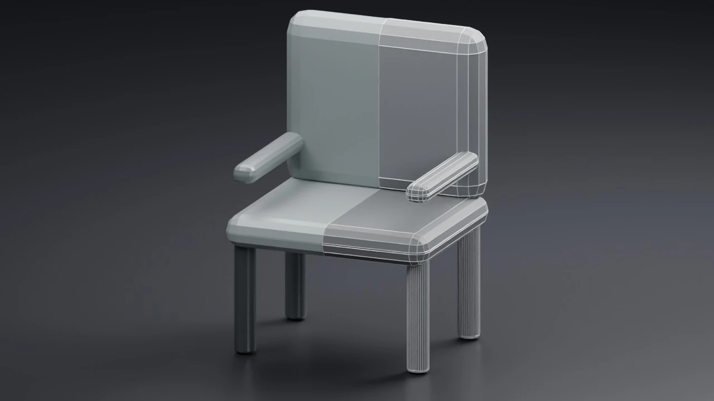

---

group: "augmented-reality-furniture"
title: "Como rever um móvel em realidade aumentada"
description: "Verifique a colocação, aparência e o percurso no dispositivo móvel voltando para a página do produto de mobiliário."
date: 2026-12-01
updated: 2026-12-01
keyword: "realidade aumentada móveis"
cta: "Reveja os ângulos do seu produto numa pré-visualização gratuita."
---

Revise um modelo de móvel em realidade aumentada num telefone compatível antes de o vincular a uma página de produto. Teste o ponto de entrada, a orientação, a colocação no chão e o retorno para o navegador. Mantenha as dimensões verificadas nas especificações do produto e utilize a sessão de realidade aumentada para avaliar a apresentação visual.

## Qual é o percurso a testar?

Abra a página voltada ao cliente no telefone alvo e toque no mesmo controlo que o cliente utilizará. Em dispositivos Apple, verifique que o ativo abre no Quick Look, quando suportado. Para outros percurso, verifique os requisitos de modo AR e do dispositivo descritos no documento do visualizador.

## O que deve ser registado?

Utilize um chão desimpedido e boa iluminação. Coloque o modelo, circule em torno dele e registe se ele está voltado para a direção pretendida e se se assenta visualmente no chão. Retorne à página do produto e confirme que a variante ativa permanece correta.

## O que deve ser verificado antes da publicação?

| Problema                                   | Diagnóstico                                            |
| ------------------------------------------ | ------------------------------------------------------ |
| O objeto aparece rotacionado               | Verifique a orientação exportada e a colocação inicial |
| A ação de realidade aumentada está ausente | Dispositivo, navegador e modo de visualização          |
| O elemento errado abre                     | Verifique a URL de origem da variante ativa            |

<!-- IMAGE PENDING: Photograph or capture the example described in the brief. -->

**Fonte** [Apple · Quick Look](https://developer.apple.com/quick-look-gallery/), [model-viewer · documentação](https://modelviewer.dev/docs/), [Apple · Preparação do conteúdo 3D para RealityKit](https://developer.apple.com/documentation/arkit/previewing-a-model-with-ar-quick-look).

[Guia relacionado](/pt/guias/ficheiro-usdz)

[Como criar um modelo 3D](/pt/guias/como-criar-um-modelo-3d)

## Perguntas frequentes

### Os compradores precisam ainda das medidas do produto?

Os compradores precisam das medidas do produto para garantir a compatibilidade. Verifique a URL de origem da variante ativa antes de publicar o conteúdo. Um erro comum é abrir a variante errada por falha na configuração da URL de origem.

### O que deve ver-se em telefones não compatíveis?

Em telefones não compatíveis, o conteúdo AR não é exibido. Abra a página do produto e verifique se a variante ativa está correta. O erro comum é que a URL de origem está incorreta, levando ao carregamento errado do modelo.

### É possível testar apenas num computador?

Pode testar o modelo de mobiliário em realidade aumentada num computador para verificações iniciais do ficheiro. Execute o percurso real num telefone com suporte antes de publicar um ponto de entrada em AR. Verifique a renderização em AR e a alinhamento do objeto no dispositivo móvel para garantir precisão.
