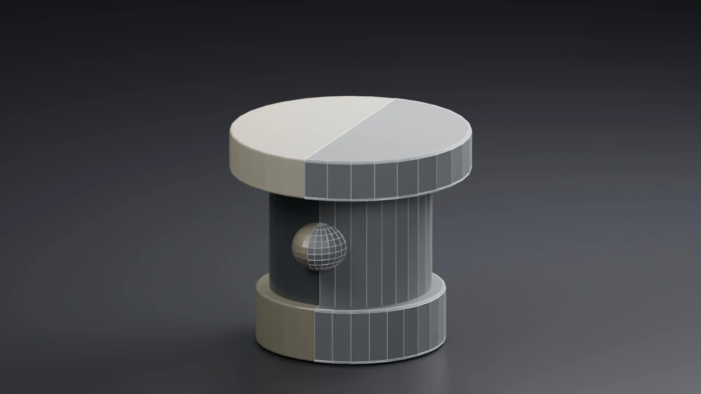

---

group: "woocommerce-3d-models"
title: "Como adicionar um visualizador 3D ao WooCommerce"
description: "Configure um visualizador de produto WooCommerce com o 3D utilizando um ficheiro GLB, uma fotografia de backup e um teste de aceitação móvel."
date: 2026-11-29
updated: 2026-11-29
keyword: "visualizador 3D WooCommerce"
cta: "Reveja os ângulos do seu produto numa pré-visualização gratuita."
---

Adicione um visualizador 3D a um produto WooCommerce em um site de staging. Utilize uma extensão se for necessário um fluxo de trabalho para o administrador, ou integre um visualizador web se controlar o template. Mantenha uma foto do produto disponível e teste a galeria no tema e nos dispositivos que os clientes utilizam.

## Como escolher a integração?

Verifique que a extensão suporte o ficheiro e a localização antes de adquirir ou instalar. Um template personalizado pode utilizar um componente como model-viewer, hospedado com o GLB e poster. Assegure-se de que a seleção de variantes e os controles de compra permaneçam funcionais.

## Que testes realizar com um único produto?

Carregue um modelo pequeno em primeiro lugar. Abra o produto numa sessão incógnito, verifique o poster, interaja com o visualizador e adicione a variante correta ao carrinho. Em conexão móvel lenta, confirme que a foto e os detalhes do produto permaneçam acessíveis.

## O que verificar antes de publicar?

| Falha                                   | Verifique                                                                 |
| --------------------------------------- | ------------------------------------------------------------------------- |
| O modelo devolve 403                    | Permissões de URL pública ou de hospedagem                                |
| O visualizador substitui toda a galeria | Localização da extensão e do tema                                         |
| A página redireciona ao carregar        | Defina uma proporção de aspecto específica para o poster e o visualizador |

<!-- IMAGE PENDING: Photograph or capture the example described in the brief. -->

**Fonte** [WooCommerce · Arty 3D Viewer](https://woocommerce.com/document/arty-3dmodelviewer/), [WooCommerce · adding products](https://woocommerce.com/document/managing-products/add-product/), [model-viewer · documentation](https://modelviewer.dev/docs/).

[Guia relacionado](/pt/guias/modelos-3d-para-ecommerce)

[Como criar um modelo 3D](/pt/guias/como-criar-um-modelo-3d)

## Perguntas frequentes

### Preciso de um plugin?

Utiliza-se um plugin ou componente integrado com suporte ao ficheiro GLB e localização pública. Carregue um modelo pequeno e verifique se o visualizador carrega sem erros no ecrã. O visualizador substitui a galeria se a extensão não estiver corretamente localizada no tema.

### O GLB é suficiente para todos os modos AR?

O GLB não é suficiente para todos os modos AR porque falta suporte a funcionalidades avançadas. Carregue o ficheiro GLB em um ecrã com conexão móvel lenta e verifique se o visualizador carrega corretamente. O erro comum é a página redirecionar ao carregar devido a uma proporção de aspecto inadequada.

### O 3D deverá aparecer em que localização?

O visualizador 3D deve aparecer ao lado das fotografias, não substituindo a galeria. Carregue o ficheiro GLB e defina a proporção de aspecto específica no ecrã. O erro comum é a substituição total da galeria por causa de uma localização incorreta da extensão.
